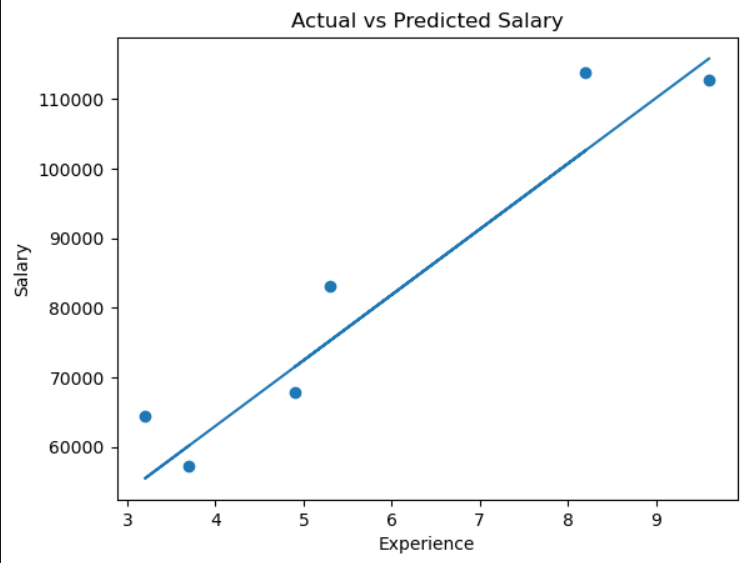

# Salary Prediction Using Simple Linear Regression

## Overview

This project uses Simple Linear Regression to predict salary based on years of work experience

## Dataset

The dataset contains 30 observations and two columns:

- `YearsExperience`: Years of work experience.
- `Salary`: Corresponding salary.

**Dataset Source:** [Salary_Data.csv](https://github.com/MainakRepositor/Datasets/blob/master/Salary_Data.csv)

## Technologies Used

- Python
- Pandas
- Matplotlib
- Scikit-learn
- Jupyter Notebook

## Methodology

1. Load and inspect the dataset.
2. Separate the input feature and target variable.
3. Split the dataset into training and testing sets.
4. Train the Simple Linear Regression model.
5. Predict salary values.
6. Visualize actual and predicted salaries.

## Visualization

The graph compares actual test-set salaries with predicted salaries across years of experience.



## Project Structure

```text id="av31ju"
salary-prediction/
├── images/
│   └── actual-vs-predicted-salary.png
├── salary_prediction.ipynb
└── README.md
```
